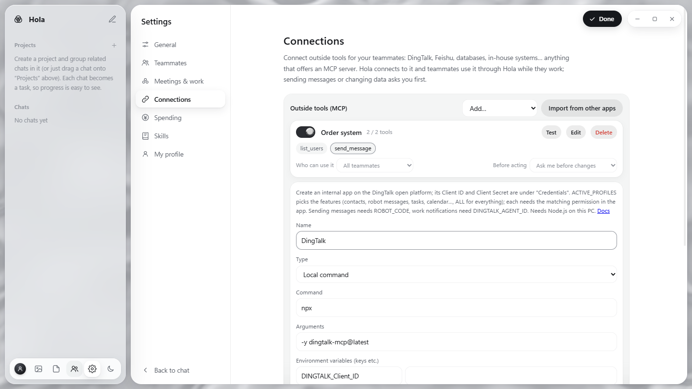

<p align="center">
  
</p>

<h1 align="center">Hola · Union of Light</h1>

<p align="center">
  <b>English</b> · <a href="README.md">中文</a>
</p>

<p align="center">
  Put Claude, Codex (ChatGPT) and Gemini in one group chat:<br>
  they <b>answer independently, at the same time</b>, then <b>discuss and challenge each other</b>,<br>
  and hand you a <b>team conclusion</b> once they agree. You just play the foreman.
</p>

<p align="center">
  <a href="#try-it-no-account-needed">Try it</a> ·
  <a href="#install-the-desktop-app-recommended">Install</a> ·
  <a href="#how-to-use">How to use</a> ·
  <a href="#add-more-ais">Add DeepSeek and others</a>
</p>

<p align="center"></p>

---

## Why

Ask the same question and Claude says one thing, ChatGPT another, Gemini a third. You copy and paste between them, and in the end you still have to decide who's right.

Hola takes a different approach: **let them argue it out**. Each model has different training and a different "personality". They think on their own first, then read each other's views, adopt what they agree with and push back with reasons where they don't, until they reach consensus. That process of judging and debating often produces a more complete answer than any one of them alone.

The name means *union of light*: red, green and blue light combined make white light.

## Features

- **One group, several AIs**: Claude, Codex and Gemini are there by default, and you can add DeepSeek, Qwen, Kimi, local models or any other AI.
- **The main brain answers first; you decide when to meet**: just send, and the "main brain" you choose (say, Claude Opus) answers alone, which is fastest. For questions worth thinking through, click "Meet", or "Ask the team to discuss" under the main brain's answer.
- **Brains and helpers**: teammates are either "brains" (join meetings) or "helpers" (no meetings, only work). The main brain thinks and reviews, and hands routine work such as tables, research, layout and long write-ups to cheaper, faster helpers. Everything handed back is **reviewed** by the main brain: approved, fixed on the spot, or sent back. The "work strategy" (automatic / quality first / balanced / save money) decides how much goes to helpers.
- **Independent, parallel answers**: in a meeting, the brains answer at the same time without seeing each other's answers for that round, so nobody anchors anybody.
- **Discussion and consensus**: a meeting discusses for at least one round, each declaring a position (*agree* / *object*), until everyone agrees or the round limit is reached. Then one teammate writes the **team conclusion**. If they agree, work is handed out straight away without you. If they're still split at the round limit, the disagreement is laid out as options and **you make the call**: pick an option or just type your decision, and the team divides the work accordingly.
- **@ to assign work and set the order**: `@Gemini research competitors first, @Claude then write the copy, @Codex put it in Excel` runs as a relay in @ order.
- **Automatic hand-offs**: if a conclusion needs hands-on work, a teammate @s the right person and they pick it up.
- **Separate memory for each conversation**: after each round Hola curates the conversation memory (goal, your preferences, decisions, progress, key files), so long chats don't lose the thread. Conversations don't share memory, and you can edit it any time.
- **Rules wall**: at the top of the memory panel, write one rule per line (for example "always write prices as ¥ plus the number"). Every teammate gets each rule word for word on every turn; rules are never shortened or forgotten. In very long chats, what you said early on is also carried along word for word.
- **Wick, so every model works steadily** (Hola's own harness):
  - Teammates continue their previous session and only get the new messages, instead of rereading everything each turn. Meetings still get the full context, so discussion quality is unchanged.
  - Replies appear word by word while they are being written.
  - API teammates (DeepSeek, Qwen…) retry when the API is rate-limited, stop and explain when stuck, see only the head and tail of very long outputs, can edit one spot in a file and search inside files, compact very long sessions into key points, and read a skill only when they need it.
  - Hola checks what this computer has (Python, Node…) and tells teammates up front. With a DeepSeek key, web search uses DeepSeek's own search, which works in mainland China.
  - Every turn writes a step log (`.hola/trace` in the conversation folder) you can replay: `node tools/wick-trace.js <conversation folder>`.
  - Safety: config files in a conversation folder that other AIs would read or even run automatically are moved to quarantine, and you're told.
  - **Delivery check**: when a teammate hands in a file, Hola opens it first: does it open, is anything unfinished ("TODO", "fill in here"), does PPT text overflow, does the deck have the number of slides you asked for, are there Excel error values, and does the file the reply says was saved actually exist. If something is badly wrong, the teammate fixes it right away (marked "Fixing after check"), and the main brain sees the check results when reviewing.
  - **Approve once, then hands-off**: when the main brain or a team conclusion hands work to teammates, Hola first shows a work plan; click "Start" and hand-offs, review, fixes and clicks in the built-in browser run on their own without asking again. Reply to change the plan, or turn the card off in Settings for fully automatic work.
  - **Task board**: above the input box you see the steps, who is on each and how far along it is; reassign a step that hasn't started or cancel one that's running. If you chime in mid-way, queued hand-offs are withdrawn and the main brain re-plans.
  - **No dropped balls**: if a teammate runs out of quota, gets logged out or goes offline, a teammate in the same role takes over that step and the chat says so; after Hola or the PC restarts, unfinished work carries on.
  - **Capability cards and a recommended setup**: Hola records how each teammate actually does (kinds of work, first-time review passes, time and cost) for the main brain to consider; Settings → "Use the recommended team setup" picks the main brain, brains and helpers in one click. The memory panel shows which providers received this chat.
  - **Gets better with use**: things you said should apply "from now on" are suggested for the rules wall; problems teammates keep hitting on this PC are suggested as "lessons from this computer"; work that passed review can be saved as a skill in one click. Nothing applies until you click. Teammates get a health check every 6 hours.
  - **Team tools**: Claude, Codex and API teammates can look at the task board and the team and hand off work themselves (still through the plan approval).
  - **Hola document standard**: Word, PowerPoint and Excel files Hola generates share one professional look (navy accent; Word gets a centered title, coloured headings, table headers, callout boxes, header and page numbers; PowerPoint gets a dark cover, cards, real tables, slide numbers and font sizes chosen to fit; Excel gets header styling, borders, thousands separators and filters). Command-line teammates get the standard's minimum rules when they make files, and can lay out or check a file with `node tools/hola-doc.js`.
- **Know what you spend**: for API teammates, each reply shows roughly what it cost. Under Settings you can set spending limits per chat and per day (¥); when a limit is reached, the team stops and tells you. DeepSeek's official prices are built in; for other models, enter a price under Teammates → Edit.
- **Multimodal**: drag or paste images and files in. Images, videos and audio the teammates generate are collected into the conversation folder (even if the AI saved them elsewhere or only returned them inline) and shown, played and downloadable right in the chat.
- **Images and Files libraries**: "Images" and "Files" in the sidebar gather everything you uploaded, sent in chats, or your teammates made, labelled with the chat it came from. Upload, search, preview, and click "Send to chat" to put one in the input box for your teammates. Uploads are stored in the workspace's "资料库" (library) folder.
- **Teammates that can't see images still get them**: if a model you added through an API can read images, tick "Can see images" under Teammates → Edit and images go straight to it; if not, Hola first asks a teammate who can see images to write a description for it.
- **Company relays work too**: the built-in Claude, Codex and Gemini can each switch from "Subscription" to "Relay / API" under Teammates → Edit: enter the address and key, click "Load available models" to pick from a list, and choose a thinking effort. No command-line tool or personal subscription needed.
- **API teammates can do work too**: teammates added through an API (DeepSeek, Qwen, GPT / Claude behind a relay, and so on) can read attachments and the library, save their work as files, produce real Word / Excel / PowerPoint files, and search and read the web. With "Full access" they can also run commands. If a model doesn't support tool calling, it falls back to thinking only.
- **Pinned team materials**: pin files in the library (brand voice, banned words, product facts…) and every teammate refers to them in every chat. The library shows the character count so you don't pin too much.
- **A folder of your own for each chat (3.2)**: click the Folder button in the header to switch the chat to a folder already on your PC (for example one with your campaign files); teammates read, write and save their work right there. Existing files are not moved, and deleting the chat removes only what Hola put there (.hola, the chat memory, text versions), never your files.
- **Outside tools (MCP, 3.1)**: under **Settings → Connections**, connect tools that offer an MCP server (DingTalk, Feishu, databases, in-house systems…) for your teammates. DingTalk has a ready template (enter the Client ID and Secret from its open platform); you can also import from Claude or Cursor on this PC, or paste the config from the server's docs. Hola connects to the server and teammates use it through Hola while they work: actions that change outside data (sending messages, creating tasks…) ask you first, and you choose which teammates may use it. Local-command servers need Node.js on the PC.
- **Built-in browser (desktop app)**: "Browser" in the header opens a real browser in the split pane on the right. You can use it yourself, and teammates (Claude, Codex and API teammates) can use it to open pages, read them, take screenshots, click buttons and fill in forms. Teammates ask you in Hola before they click or type (you can choose "Allow for this chat", or turn the question off in Settings).
- **"Silver mercury + layered glass" interface (3.0)**: silver and white only, in light and dark. The sidebar, the chat and the preview are three floating rounded glass panels over a still liquid-silver backdrop, layer on layer; icons replace text wherever possible, with a tooltip when you hover. Teammate avatars are each vendor's own logo in silver (Claude, OpenAI, Gemini, DeepSeek, Qwen, Kimi and more, 22 in all), recognised automatically from the API address and model name. Mercury only moves when something happens: in the header each teammate is a drop of mercury placed on a regular shape (triangle, square…) that breathes slowly when idle, merges and splits again during a meeting and melts into one pool at the conclusion; the send button and the switches are mercury too, still until you touch them; and when the main brain approves a delivery, a drop flows into a check mark. Every dialog is drawn by Hola.
- **Reads Office documents**: Word, Excel and PowerPoint files get an automatic text version (headings, paragraphs, tables, multiple sheets, dates, slides and speaker notes), so every teammate can read them, including API-based ones. Click "Preview" to open documents, PDFs and images in a split pane next to the chat; the divider and sidebar can be dragged, and the chat area switches between standard, wide and full width.
- **Projects**: group related chats into projects in the sidebar. Each chat is a task you can tick off or drag between projects, with progress shown next to the project. Teammates on every task see the project brief and take into account what the project's other tasks decided, so work stays consistent.
- **Shared skill library**: turn what worked into a *skill* (steps, who does what, standards, templates, lessons learned) that every chat and every teammate shares. Click "Save as skill" next to a team conclusion and a teammate writes it up; next time a similar task comes in, teammates read the skill before starting, and the message shows which skill was used. The format matches Claude Skills (SKILL.md), so existing skills can be imported.
- **Pick models, see usage**: under Teammates → Edit, choose the model for Claude, Codex and Gemini (say, Opus or Sonnet for Claude) and the thinking effort (low / medium / high…); the lists come straight from each company's command-line tool. Each reply shows the model it used and its usage (input / output tokens), and the teammate status at the top right shows this conversation's total per teammate. On a subscription, usage counts toward your plan's quota and nothing extra is billed.
- **Delete means delete**: deleting a conversation permanently removes its history, memory, attachments and output files.
- **Your profile**: upload an avatar and say who you are, what to call you, how detailed and what tone you want, whether discussions should be gentle or sharp, and any standing requests. Every teammate follows it in every conversation.
- **No log spam**: while working, teammates just show a status like "Tightening screws", "Digging through files" or "Bathroom break, back soon" instead of raw commands and logs. To troubleshoot, turn on "Show the backend process" in Settings to see the files they read, the commands they ran and the raw errors.
- **Choose who works**: click a name under the input box to leave that teammate out this time.
- **English and Chinese UI**: switch under **Settings → 界面语言 / Language**. Teammates reply in the interface language unless you write to them in another one.
- **Runs on your own computer**: it uses the subscriptions you already pay for (through each vendor's official CLI), with no third-party server in between.

<table>
<tr>
<td></td>
<td></td>
</tr>
<tr>
<td align="center">Answering independently, at the same time</td>
<td align="center">Internal discussion: agree / object</td>
</tr>
</table>

## Try it (no account needed)

To see how it works first, use **demo mode**: teammates follow a scripted reply instead of calling real AIs. Just send to see the main brain answer alone; click **Meet** next to the input box to get the whole flow (parallel answers → discussion → team conclusion → hand-off → memory).

1. Install [Node.js](https://nodejs.org/) (LTS, 18 or later).
2. Download this project (green **Code** button → **Download ZIP**) and unzip it.
3. Windows: double-click `START-DEMO.bat`. Mac: in Terminal, type `bash ` (with a trailing space), drag `mac/START-DEMO.command` into the window and press Enter. Other systems: run `node server.js --demo` in the project folder.
4. Open <http://localhost:3457> and pick **English** under **Settings → 界面语言 / Language** if it isn't already.

## Install the desktop app (recommended)

Download the installer from the [Releases page](https://github.com/Julianniu/hola-multi-ai/releases/latest):

| System | Download |
|---|---|
| Windows 10 / 11 | `Hola-Setup-x.y.z.exe` |
| Mac (Apple silicon: M1 / M2 / M3 / M4…) | `Hola-x.y.z-mac-arm64.dmg` (beta) |
| Mac (Intel) | `Hola-x.y.z-mac-x64.dmg` (beta) |

- Double-click to install; no need to install Node.js first. Hola then appears on your desktop and in the Start menu.
- **The first launch shows a system warning** (Hola doesn't use a paid developer certificate). On Windows, when you see "Windows protected your PC", click "More info" → "Run anyway". On Mac, if it says the developer can't be verified, right-click Hola in Applications → "Open" (on newer macOS: System Settings → Privacy & Security → "Open Anyway"). This is only needed once.
- **Closing the window doesn't quit** (Windows): the X tucks Hola into the tray at the bottom right of the screen and teammates keep working. Click the tray icon to open it; right-click → "Quit Hola" quits for real (it stops working teammates first). When something needs you (a teammate wants to click on a page, an update is ready), a notification pops up there.
- **Automatic updates**: Hola downloads new versions in the background, checks the author's digital signature before using them, and asks before restarting. The occasional update that needs a new installer sends you to the download page. You can also check any time with the mercury button in Settings → Updates; if GitHub's API refuses, Hola tries another route, and the reason for a failed check is shown in Settings and written to a log.
- Conversation folders live in DocumentsHola; settings and API keys in the system's app-data folder.
- To use Claude, Codex and Gemini as command-line teammates you still need their official CLIs installed and signed in (see the zip version below; `SETUP.bat` installs them). API teammates such as DeepSeek need nothing extra.

## Zip version (Windows)

**You need:**
- Windows 10 / 11
- [Node.js](https://nodejs.org/) LTS (18 or later)
- At least one subscription: Claude Pro/Max (for Claude), ChatGPT Plus/Pro (for Codex), Google AI Pro (for Gemini). A teammate without a subscription just shows as offline; the others still work.

**Steps:**
1. Download and unzip the project somewhere simple, such as `D:\hola` (preferably no spaces in the path).
2. Double-click `SETUP.bat`. It installs the three official CLIs, walks you through signing in to each in your browser, and creates a **Hola** icon on your desktop.
3. From then on, double-click the **Hola** desktop icon. It starts quietly in the background and opens in its own window, with no command-prompt window left behind.

> **Sign in to the command-line teammates first**: Claude, Codex and Gemini (and any AI you add as a "command line" teammate) run through each vendor's official CLI on your own subscription, so each must be signed in on this computer once, or it shows as offline. `SETUP.bat` walks you through it; to sign in again later, double-click `Login-Claude.bat`, `Login-Codex.bat` or `Login-Gemini.bat`. API teammates only need an API key. See [GUIDE.html](GUIDE.html) for details.
>
> **Claude sign-in**: choose to sign in with your **Claude account (subscription)**. If Hola shows `API Usage Billing`, Claude is using pay-as-you-go API billing; double-click `Login-Claude.bat` to sign in again.
>
> **Gemini**: since June 2026 Google no longer lets personal subscriptions use the Gemini CLI; it was replaced by the [Antigravity CLI](https://antigravity.google/docs/cli/install/) (`agy`). `SETUP.bat` and `Login-Gemini.bat` already use it.

## Zip version (Mac, beta)

> The Mac version is the same app as the Windows one; only installing and launching differ. **It hasn't been fully tested on a real Mac yet.** Please report problems in Issues.

**You need:** macOS, [Node.js](https://nodejs.org/) LTS (18 or later), and the same subscriptions as on Windows.

**Steps:**
1. Download this project (green **Code** button → **Download ZIP**) and unzip it somewhere permanent, such as a `hola` folder in Documents.
2. Open Terminal (search for "Terminal" in Launchpad), type `bash ` (with a trailing space), drag `SETUP.command` from the `mac` folder into the window and press Enter. It installs the three official CLIs (no admin password needed), walks you through signing in, and creates the **Hola** app.
3. From then on, open **Hola** from Launchpad or your desktop.

After SETUP has run once, the other files in the `mac` folder can be double-clicked: `START.command` (debug mode, shows errors), `START-DEMO.command` (demo mode), and `Login-Claude.command` / `Login-Codex.command` / `Login-Gemini.command` (sign in again). If you move the Hola folder, run `SETUP.command` again.

Linux: the core also works there. Run `node server.js` and open <http://localhost:3456>; there are no dedicated setup scripts yet.

## How to use

| You want | Send |
|---|---|
| A quick answer | Just send (no @); the main brain answers alone |
| The team to meet and reach a conclusion | Click **Meet** next to the input box, or write `@all` |
| The team to take another look at the main brain's answer | Click **Ask the team to discuss** under that answer |
| One specific teammate to do it | `@Codex turn this data into a chart` |
| A relay in a set order | `@Gemini read the attached material first, @Claude then write the plan` |
| To leave someone out this time | Click their name under the input box |
| Standing rules for the team | Write them in **Memory** (top right), such as brand voice or banned words |
| To stop mid-way | Click **Stop** |

Under **Settings** (bottom left) you can set the interface language, the **main brain** (it answers plain messages, writes the team conclusion in meetings and reviews whatever teammates hand back), the work strategy, the maximum number of discussion rounds (default 3), how many automatic hand-offs are allowed, and whether memory is updated automatically.

<p align="center"></p>

## Add more AIs

**Teammates → Add teammate** (bottom left), in two ways:

- **API**: any OpenAI-compatible endpoint, with presets for DeepSeek, Qwen, Kimi, Zhipu GLM, OpenRouter and local Ollama. Enter the API key and click **Save and test**.
- **Command line**: any AI that has a CLI. Enter the command and its arguments; `{PROMPT}` in the arguments is replaced with the task (otherwise it is sent on standard input).

<p align="center"></p>

<p align="center"></p>

Teammates added through an API can do work by default: read and write files in the chat folder, produce Word / Excel / PowerPoint files, search and read the web, and use the built-in browser; with "Full access" they can also run commands. This needs a model that supports tool calling. "Save and test" checks it; if it isn't supported, the teammate only thinks (no files, no web, and text attachments you send are included for it directly); images are sent as images if "Can see images" is ticked, otherwise a teammate who can see them writes a description. They work best as an extra independent voice in discussions. APIs are usually billed by usage, so keep an eye on your provider's dashboard.

## How it works

```
You send a message
  ├─ @ someone ──→ run in @ order ──→ teammates can @ each other to hand off
  ├─ just send ──→ the main brain answers alone (may @ helpers for routine work)
  │                └─ you click "Ask the team to discuss" ──┐
  └─ "Meet" / @all ─────────────────────────────────────────┴─→ the brains answer independently, at the same time
                                                                └─→ internal discussion, at least one round (each round: agree / object)
                                                                    ├─ all agree ──→ main brain writes the team conclusion ──→ @ teammates for hands-on work
                                                                    └─ still split at the limit ──→ options ──→ boss decides ──→ @ teammates per the decision
Work handed back ──→ the main brain reviews it (approve / fix on the spot / send back)
After each round ──→ the conversation memory is updated automatically
```

Helpers never join meetings; they only take work. Meetings are for the "brains".

- Hola itself is a small zero-dependency Node.js app (`server.js` + `public/index.html`) that listens on `127.0.0.1` only.
- Each teammate is driven through its vendor's **official CLI** (`claude -p` for Claude Code, `codex exec` for Codex, `agy -p` for Antigravity) or through an OpenAI-compatible API.
- Each conversation is its own folder under `workspace/`, holding the chat history, the conversation memory, attachments and output files.

## Security and privacy

- It listens on your own computer only; your local network and other websites can't reach it. Every write request needs a dedicated header, so web pages can't call it behind your back.
- Conversations, memory and API keys are stored only on your computer (`workspace/`, `data/`), and both folders are in `.gitignore` so they can't be committed by accident.
- Default teammate permissions: Claude can read and write files and look things up, but not run commands; Codex runs in its own sandbox and can only change the working folder; Gemini is read-only. To give a teammate more power (run commands, change files anywhere on the PC), tick "Full access" under **Teammates → Edit** at the bottom left; no need to edit `config.json`. **Make sure you understand the risks before granting more**.
- The built-in browser (desktop app) is separate from your everyday browser; sign-ins are kept only inside Hola. By default teammates ask you before they click or type in it; it won't open local addresses (protecting Hola itself) or local files, and it refuses every page's request for camera, microphone, location and similar permissions. Note: on sites you're signed in to there, teammates act as you.
- Teammates follow the skills in the library, so only import skills you trust, and read them first under Skills → Edit.
- This project is not affiliated with Anthropic, OpenAI, Google, DeepSeek or any other company. It only calls the official tools and APIs they publish. Follow each service's terms; subscription quotas and API costs are charged to your own accounts.

## FAQ

**A teammate is grey / offline?** Click the dots at the top right to see why. Usually the CLI isn't installed or the sign-in expired. Sign in again, then click **Recheck**.

**Nothing happens when I double-click the icon?** Double-click `START.bat` to see a window with logs, and use the error message to troubleshoot, or attach a screenshot when you open an issue.

**Does it use a lot of quota?** A plain send costs one answer from the main brain (plus one memory update), the cheapest option. A meeting costs one answer per brain, one more each per discussion round, then one conclusion and one memory update. When the main brain hands work to a helper, add one turn for the helper and one for the review. So send everyday questions directly and save meetings for the ones worth thinking through; for hands-on tasks you can also @ a specific teammate.

**Can I see the AIs' full reasoning?** You see what they say in the group, which files they read and wrote, which commands they ran, and whatever thinking summaries each vendor exposes. Some vendors don't expose the model's full underlying reasoning.

## Contributing

Issues and pull requests are welcome (by submitting one you agree that the author may use your changes under this project's license), especially for: testing the Mac version on a real Mac, launchers for Linux, more AI presets, and more interface languages.

To work on the interface and flow without signing in to anything, use demo mode: `node server.js --demo` (the teammates' script is in `demo/fake-ai.js`). Interface strings live in `public/i18n.js`.

## Contact

Questions, ideas or partnership proposals: please leave a message in [Issues](https://github.com/Julianniu/hola-multi-ai/issues).

## License

Since October 2026, Hola is licensed under the [PolyForm Internal Use License 1.0.0](LICENSE):

- ✅ Individuals and companies may use it free of charge, including for their work;
- ✅ you may modify it for your own or your company's use;
- ❌ you may not distribute it (modified or not): no passing on copies, reselling, republishing, or offering it as a product or service. To recommend it, point people to this page.

For anything not covered above (commercial partnerships, distribution), contact the author through [Issues](https://github.com/Julianniu/hola-multi-ai/issues). Versions released before October 2026 remain under the Apache License 2.0 they were released with.

**Official build badge**: releases carry the author's digital signature (`release.json`). The version number is at the bottom of the **Settings** window; if program files have been changed, the top left shows "Unofficial", and clicking it lists the files that differ.
