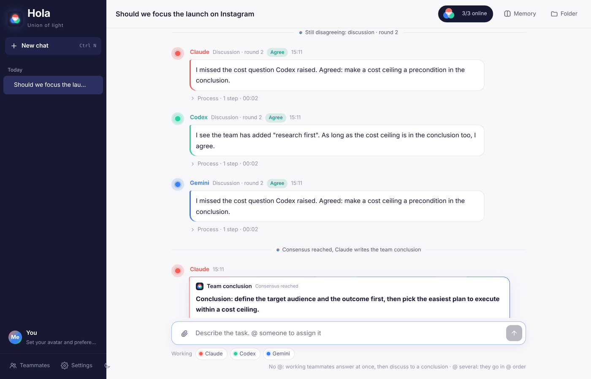
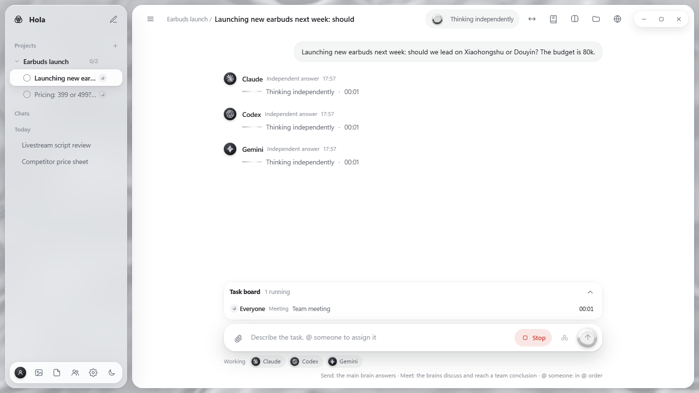
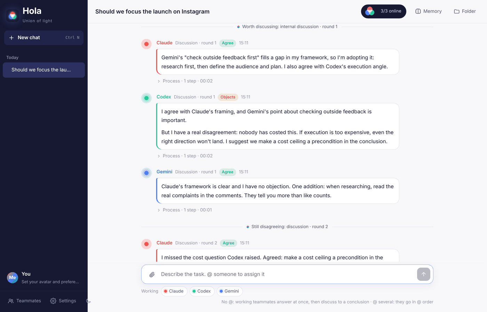
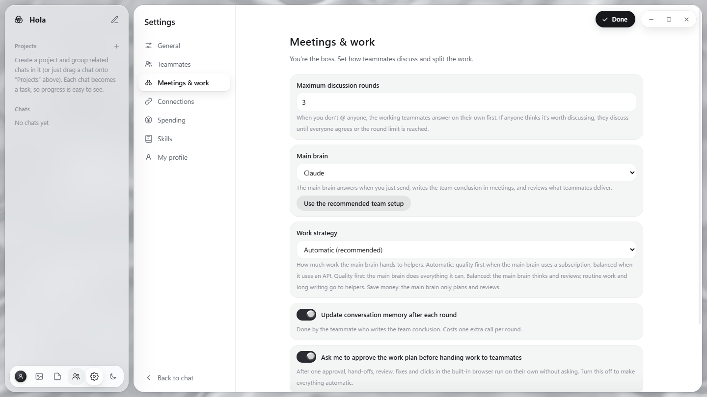
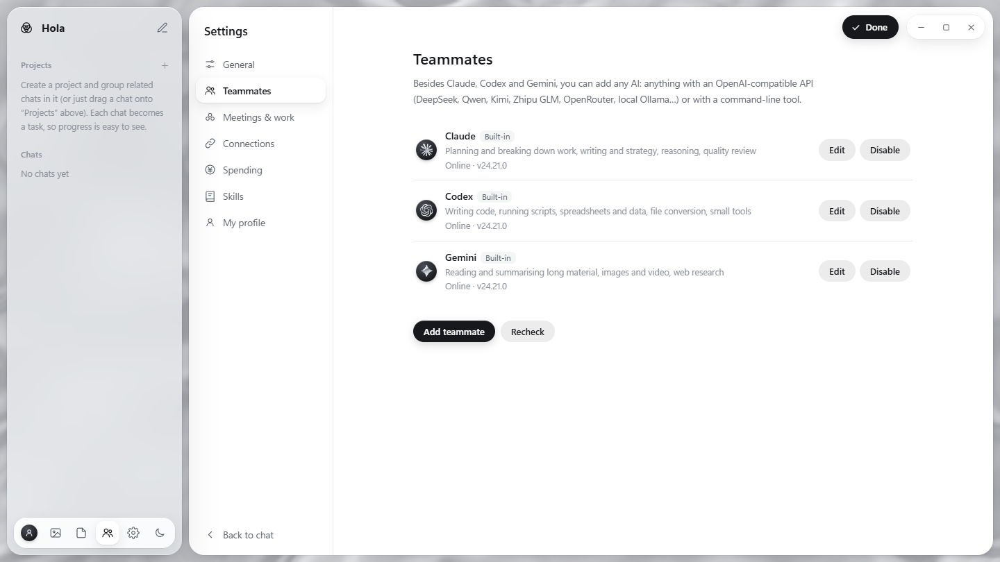

<p align="center">
  
</p>

<h1 align="center">Hola · Union of Light</h1>

<p align="center">
  <b>English</b> · <a href="README.md">中文</a>
</p>

<p align="center">
  Put Claude, Codex (ChatGPT) and Gemini in one group chat:<br>
  they <b>answer independently, at the same time</b>, then <b>discuss and challenge each other</b>,<br>
  and hand you a <b>team conclusion</b> once they agree. You just play the foreman.
</p>

<p align="center">
  <a href="#try-it-no-account-needed">Try it</a> ·
  <a href="#install-windows">Install</a> ·
  <a href="#how-to-use">How to use</a> ·
  <a href="#add-more-ais">Add DeepSeek and others</a>
</p>

<p align="center"></p>

---

## Why

Ask the same question and Claude says one thing, ChatGPT another, Gemini a third. You copy and paste between them, and in the end you still have to decide who's right.

Hola takes a different approach: **let them argue it out**. Each model has different training and a different "personality". They think on their own first, then read each other's views, adopt what they agree with and push back with reasons where they don't, until they reach consensus. That process of judging and debating often produces a more complete answer than any one of them alone.

The name means *union of light*: red, green and blue light combined make white light.

## Features

- **One group, several AIs**: Claude, Codex and Gemini are there by default, and you can add DeepSeek, Qwen, Kimi, local models or any other AI.
- **Independent, parallel answers**: when you don't @ anyone, the working teammates answer at the same time without seeing each other's answers for that round, so nobody anchors anybody.
- **Autonomous discussion and consensus**: each teammate decides whether the question is worth discussing. If so, they discuss for several rounds, each declaring a position (*agree* / *object*), until everyone agrees or the round limit is reached. Then one teammate writes the **team conclusion**. You don't have to step in, but you can watch all of it.
- **@ to assign work and set the order**: `@Gemini research competitors first, @Claude then write the copy, @Codex put it in Excel` runs as a relay in @ order.
- **Automatic hand-offs**: if a conclusion needs hands-on work, a teammate @s the right person and they pick it up.
- **Separate memory for each conversation**: after each round Hola curates the conversation memory (goal, your preferences, decisions, progress, key files), so long chats don't lose the thread. Conversations don't share memory, and you can edit it any time.
- **Multimodal**: drag or paste images and files in. Images, videos and audio the teammates generate are collected into the conversation folder (even if the AI saved them elsewhere or only returned them inline) and shown, played and downloadable right in the chat.
- **Reads Office documents**: Word, Excel and PowerPoint files get an automatic text version (headings, paragraphs, tables, multiple sheets, dates, slides and speaker notes), so every teammate can read them, including API-based ones. Click "Preview" to view documents and PDFs in the app.
- **Projects**: group related chats into projects in the sidebar. Each chat is a task you can tick off or drag between projects, with progress shown next to the project. Teammates on every task see the project brief and take into account what the project's other tasks decided, so work stays consistent.
- **Shared skill library**: turn what worked into a *skill* (steps, who does what, standards, templates, lessons learned) that every chat and every teammate shares. Click "Save as skill" next to a team conclusion and a teammate writes it up; next time a similar task comes in, teammates read the skill before starting, and the message shows which skill was used. The format matches Claude Skills (SKILL.md), so existing skills can be imported.
- **Delete means delete**: deleting a conversation permanently removes its history, memory, attachments and output files.
- **Your profile**: upload an avatar and say who you are, what to call you, how detailed and what tone you want, whether discussions should be gentle or sharp, and any standing requests. Every teammate follows it in every conversation.
- **No log spam**: while working, teammates just show a status like "Tightening screws", "Digging through files" or "Bathroom break, back soon" instead of raw commands and logs. To troubleshoot, turn on "Show the backend process" in Settings to see the files they read, the commands they ran and the raw errors.
- **Choose who works**: click a name under the input box to leave that teammate out this time.
- **English and Chinese UI**: switch under **Settings → 界面语言 / Language**. Teammates reply in the interface language unless you write to them in another one.
- **Runs on your own computer**: it uses the subscriptions you already pay for (through each vendor's official CLI), with no third-party server in between.

<table>
<tr>
<td></td>
<td></td>
</tr>
<tr>
<td align="center">Answering independently, at the same time</td>
<td align="center">Internal discussion: agree / object</td>
</tr>
</table>

## Try it (no account needed)

To see how it works first, use **demo mode**: teammates follow a scripted reply instead of calling real AIs, and you get the whole flow (parallel answers → discussion → team conclusion → hand-off → memory).

1. Install [Node.js](https://nodejs.org/) (LTS, 18 or later).
2. Download this project (green **Code** button → **Download ZIP**) and unzip it.
3. Windows: double-click `START-DEMO.bat`. Other systems: run `node server.js --demo` in the project folder.
4. Open <http://localhost:3457> and pick **English** under **Settings → 界面语言 / Language** if it isn't already.

## Install (Windows)

**You need:**
- Windows 10 / 11
- [Node.js](https://nodejs.org/) LTS (18 or later)
- At least one subscription: Claude Pro/Max (for Claude), ChatGPT Plus/Pro (for Codex), Google AI Pro (for Gemini). A teammate without a subscription just shows as offline; the others still work.

**Steps:**
1. Download and unzip the project somewhere simple, such as `D:\hola` (preferably no spaces in the path).
2. Double-click `SETUP.bat`. It installs the three official CLIs, walks you through signing in to each in your browser, and creates a **Hola** icon on your desktop.
3. From then on, double-click the **Hola** desktop icon. It starts quietly in the background and opens in its own window, with no command-prompt window left behind.

> **Sign in to the command-line teammates first**: Claude, Codex and Gemini (and any AI you add as a "command line" teammate) run through each vendor's official CLI on your own subscription, so each must be signed in on this computer once, or it shows as offline. `SETUP.bat` walks you through it; to sign in again later, double-click `Login-Claude.bat`, `Login-Codex.bat` or `Login-Gemini.bat`. API teammates only need an API key. See [GUIDE.html](GUIDE.html) for details.
>
> **Claude sign-in**: choose to sign in with your **Claude account (subscription)**. If Hola shows `API Usage Billing`, Claude is using pay-as-you-go API billing; double-click `Login-Claude.bat` to sign in again.
>
> **Gemini**: since June 2026 Google no longer lets personal subscriptions use the Gemini CLI; it was replaced by the [Antigravity CLI](https://antigravity.google/docs/cli/install/) (`agy`). `SETUP.bat` and `Login-Gemini.bat` already use it.

macOS / Linux: the core is a zero-dependency Node.js app, so run `node server.js` and open <http://localhost:3456>. The desktop launcher and setup scripts are Windows-only for now and the app hasn't been fully tested on these systems. Contributions welcome.

## How to use

| You want | Send |
|---|---|
| The team to discuss and reach a conclusion | Just ask, without @-ing anyone |
| One specific teammate to do it | `@Codex turn this data into a chart` |
| A relay in a set order | `@Gemini read the attached material first, @Claude then write the plan` |
| To leave someone out this time | Click their name under the input box |
| Standing rules for the team | Write them in **Memory** (top right), such as brand voice or banned words |
| To stop mid-way | Click **Stop** |

Under **Settings** (bottom left) you can set the interface language, the maximum number of discussion rounds (default 3), who writes the team conclusion, how many automatic hand-offs are allowed, and whether memory is updated automatically.

<p align="center"></p>

## Add more AIs

**Teammates → Add teammate** (bottom left), in two ways:

- **API**: any OpenAI-compatible endpoint, with presets for DeepSeek, Qwen, Kimi, Zhipu GLM, OpenRouter and local Ollama. Enter the API key and click **Save and test**.
- **Command line**: any AI that has a CLI. Enter the command and its arguments; `{PROMPT}` in the arguments is replaced with the task (otherwise it is sent on standard input).

<p align="center"></p>

Teammates added through an API can only "think": they can't read or write files or go online, and text attachments you send are included for them directly. They work best as an extra independent voice in discussions. APIs are usually billed by usage, so keep an eye on your provider's dashboard.

## How it works

```
You send a message
  ├─ with @ ──→ run in @ order ──→ teammates can @ each other to hand off
  └─ no @   ──→ working teammates answer independently (each decides: worth discussing?)
                  ├─ nobody thinks so ──→ done
                  └─ someone does ──→ internal discussion (each round: agree / object)
                                         └─ all agree or limit reached ──→ team conclusion ──→ @ teammates for hands-on work
After each round ──→ the conversation memory is updated automatically
```

- Hola itself is a small zero-dependency Node.js app (`server.js` + `public/index.html`) that listens on `127.0.0.1` only.
- Each teammate is driven through its vendor's **official CLI** (`claude -p` for Claude Code, `codex exec` for Codex, `agy -p` for Antigravity) or through an OpenAI-compatible API.
- Each conversation is its own folder under `workspace/`, holding the chat history, the conversation memory, attachments and output files.

## Security and privacy

- It listens on your own computer only; your local network and other websites can't reach it. Every write request needs a dedicated header, so web pages can't call it behind your back.
- Conversations, memory and API keys are stored only on your computer (`workspace/`, `data/`), and both folders are in `.gitignore` so they can't be committed by accident.
- Default teammate permissions: Claude can read and write files and look things up, but not run commands; Codex runs in its own sandbox and can only change the working folder; Gemini is read-only. To give a teammate more power (run commands, change files anywhere on the PC), tick "Full access" under **Teammates → Edit** at the bottom left; no need to edit `config.json`. **Make sure you understand the risks before granting more**.
- Teammates follow the skills in the library, so only import skills you trust, and read them first under Skills → Edit.
- This project is not affiliated with Anthropic, OpenAI, Google, DeepSeek or any other company. It only calls the official tools and APIs they publish. Follow each service's terms; subscription quotas and API costs are charged to your own accounts.

## FAQ

**A teammate is grey / offline?** Click the dots at the top right to see why. Usually the CLI isn't installed or the sign-in expired. Sign in again, then click **Recheck**.

**Nothing happens when I double-click the icon?** Double-click `START.bat` to see a window with logs, and use the error message to troubleshoot, or attach a screenshot when you open an issue.

**Does it use a lot of quota?** Without @, each working teammate answers at least once; if they discuss, each answers once more per round, plus one conclusion and one memory update. For simple questions they decide no discussion is needed and stop. For hands-on tasks, @ a specific teammate to save quota.

**Can I see the AIs' full reasoning?** You see what they say in the group, which files they read and wrote, which commands they ran, and whatever thinking summaries each vendor exposes. Some vendors don't expose the model's full underlying reasoning.

## Contributing

Issues and pull requests are welcome, especially for: launchers for macOS / Linux, more AI presets, and more interface languages.

To work on the interface and flow without signing in to anything, use demo mode: `node server.js --demo` (the teammates' script is in `demo/fake-ai.js`). Interface strings live in `public/i18n.js`.

## Contact

Questions, ideas or partnership proposals: please leave a message in [Issues](https://github.com/Julianniu/hola-multi-ai/issues).

## License

[Apache License 2.0](LICENSE)
