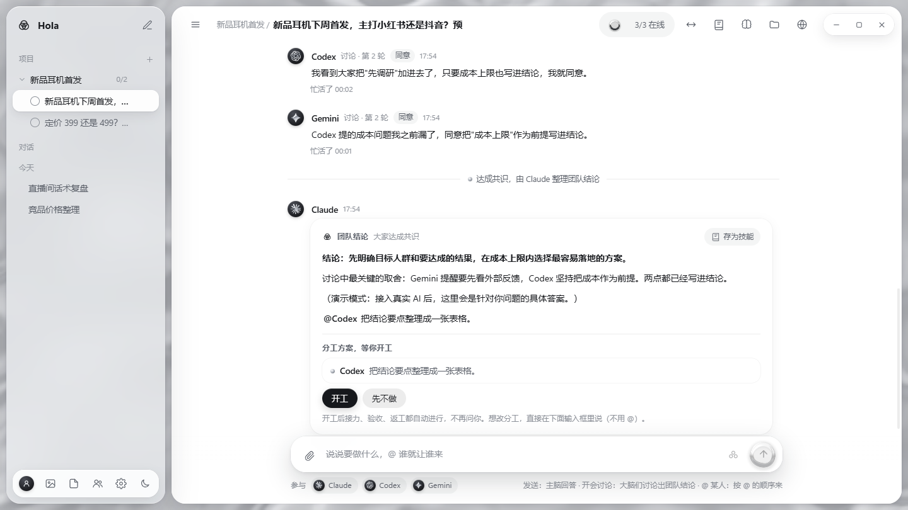
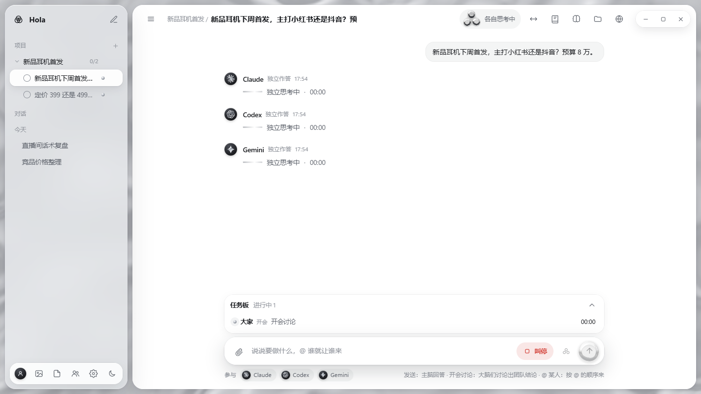
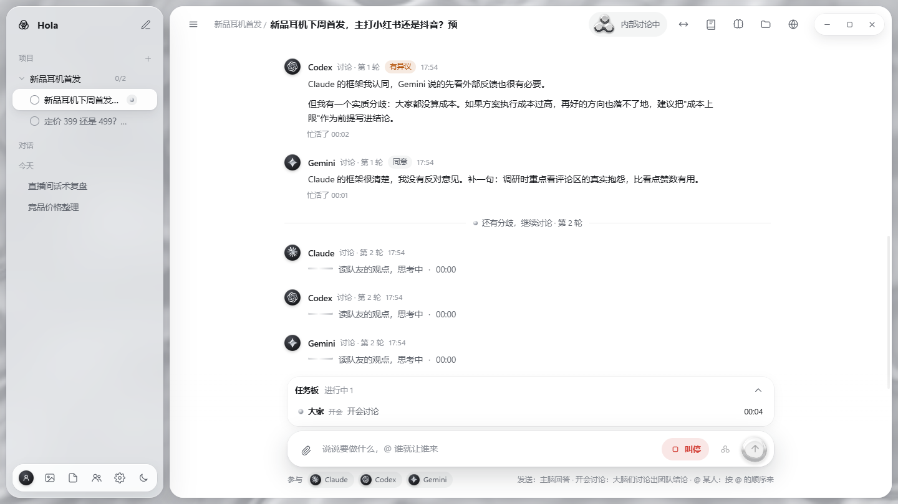
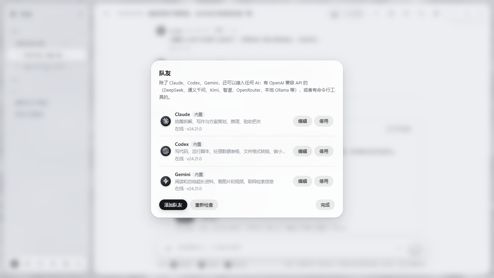

<p align="center">
  
</p>

<h1 align="center">Hola · 光辉联合</h1>

<p align="center">
  <a href="README.en.md">English</a> · <b>中文</b>
</p>

<p align="center">
  把 Claude、Codex（ChatGPT）、Gemini 拉进同一个群：<br>
  它们<b>同时独立作答</b>，再<b>自己讨论、互相挑刺</b>，达成共识后给你一份<b>团队结论</b>。<br>
  你只需要当包工头。
</p>

<p align="center">
  <a href="#快速体验不需要任何账号">快速体验</a> ·
  <a href="#安装桌面版推荐">安装</a> ·
  <a href="#怎么用">怎么用</a> ·
  <a href="#接入更多-ai">接入 DeepSeek 等</a>
</p>

<p align="center"></p>

---

## 为什么做这个

同一个问题，Claude 说一套，ChatGPT 说一套，Gemini 又是一套。来回复制粘贴，最后还得自己判断谁对。

Hola 换了个思路：**让它们自己讨论**。每个模型的训练数据和"性格"不一样，先各自独立思考，再互相看对方的观点，认同的吸收、不同意的说出理由，直到形成共识。这个判断和讨论的过程，往往比任何一家单独给的答案更周全。

名字取"光辉联合"之意：红、绿、蓝三束光叠在一起，就变成白光。

## 功能

- **一个群，多个 AI**：Claude、Codex、Gemini 默认都在，还能接入 DeepSeek、通义千问、Kimi、本地模型等任意 AI。
- **主脑先答，要开会时你说了算**：直接发送，由你指定的"主脑"（比如 Claude Opus）一个人回答，最快。值得多想想的问题，点"开会讨论"，或者在主脑的回答下面点"让大家讨论一下"。
- **大脑和帮手**：队友分成"大脑"（参与开会讨论）和"帮手"（不开会，只接活）。主脑负责想和审，把做表、搜资料、排版、长文这类粗活交给便宜快速的帮手，交回来的东西一律由主脑**验收**：通过、直接改好，或者退回重做。交多少活给帮手由"干活策略"决定（自动 / 质量优先 / 均衡 / 省钱）。
- **同时独立作答**：开会时，参与的大脑先同时回答，互相看不到这一轮的答案，避免互相带偏。
- **讨论、形成共识**：开会后至少讨论一轮，每轮亮出立场（同意 / 有异议），直到全员同意或到达轮数上限，最后由一位队友写出**团队结论**。达成共识就直接分工开干，不用你插手；到了轮数上限还没谈拢，就把分歧整理成几个方案**等你拍板**：点一个方案，或者直接打字说你的决定，队友再按你的决定分工。
- **@ 指定谁做、按什么顺序做**：`@Gemini 先查竞品，@Claude 再写文案，@Codex 做成 Excel`，按 @ 的顺序依次接力。
- **队友之间自动交接**：结论里需要动手的部分，队友会 @ 对应的人，对方自动接手。
- **每个对话独立记忆**：每轮结束后自动整理"对话记忆"（目标、你的偏好、已定结论、进度、重要文件），聊再久也不会忘。不同对话之间互不相通，你也可以随时手动修改。
- **规矩墙**：在"对话记忆"最上面一行一条写下规矩（比如"价格一律写成 ¥ 加数字"），每一轮都会原样告诉所有队友，不压缩、不会忘。聊得很久时，你较早说过的话也会原样带上。
- **Wick：让每个模型稳定发光**（Hola 自己的 harness）：
  - 队友接着上次的会话干活，只送新消息，不用每轮从头读文件；开会讨论照旧送完整内容，质量不变。
  - 队友写回答时，字一点点冒出来，不用干等。
  - API 队友（DeepSeek、千问……）遇到限流会自动重试，卡住会及时停下说明原因；长输出只给开头结尾；能只改文件里的一处、在文件里搜索；对话太长会自动压缩成要点；技能用到才读。
  - 启动时查一遍电脑上有什么（Python、Node……）告诉队友，少走冤枉路；有 DeepSeek Key 时联网搜索用 DeepSeek 自己的搜索，国内也能用。
  - 每一轮都记一份步骤日志（对话文件夹的 `.hola/trace`），出了问题能回放：`node tools/wick-trace.js <对话文件夹>`。
  - 安全：对话文件夹里会被其他 AI 自动读取、甚至自动执行的配置文件，会被挪进隔离区并告诉你。
  - **交付前检查**：队友交了文件，Hola 先自己打开看一遍——打不打得开、有没有"TODO / 此处填写"这种没写完的地方、PPT 字有没有溢出、页数是不是你要的、Excel 有没有错误值、说"已保存"的文件到底在不在。有硬伤就让 Ta 马上返工一次（标着"自查返工"），主脑验收时也能看到检查结果。
  - **开工只确认一次**：主脑或团队结论要把活分给队友时，先出一张"分工方案"卡，你点"开工"后，接力、验收、返工、浏览器里的点击都自动进行，不再逐个问你。想改分工直接回一句话；"设置"里可以改成全自动。
  - **任务板**：输入框上方列出这件事拆成了哪几步、谁在做、做到哪；还没开始的可以改派给别人，正在做的可以取消。干到一半你插话改了要求，没开始的接力先撤下，主脑按新要求重新安排。
  - **不怕掉链子**：某位队友额度用完、登录失效或掉线，这一步自动换一位同角色的队友顶上，并在群里说明；Hola 或电脑重启后，没做完的活接着做。
  - **能力卡和推荐配置**：Hola 记下每位队友实际干得怎么样（做过哪类活、验收一次过几次、平均用时和花费），主脑派活时参考；"设置 → 按推荐配置团队"一键排好谁当主脑、谁当帮手。对话记忆里能看到这个对话的内容发给过哪些服务商。
  - **越用越好**：你说过"以后都这样"的要求，会被提出来建议加进规矩墙；队友在这台电脑上反复踩的坑，会建议记成"本机经验"；验收通过的活，可以一键存成技能。这些都要你点一下才生效。每 6 小时给队友做一次体检。
  - **团队工具**：Claude、Codex 和 API 队友干活时能自己看任务板、看队友、交活（和写 @ 一样要过开工确认）。
  - **Hola 文档标准**：Hola 自己生成的 Word / PPT / Excel 有统一的专业版式（深蓝主色；Word 有居中大标题、彩色小标题、表头、提示框、页眉页码；PPT 有深色封面、卡片、真表格、页码，字号按内容自动挑放得下的；Excel 有表头、边框、千分位、筛选）。命令行队友做文件时也会拿到这套标准的最低要求，还能用 `node tools/hola-doc.js` 一键排版或检查。
- **花费心里有数**：通过 API 接入的队友，每条回复下面标出大约花了多少钱。"设置"里可以给每个对话、每天设花费上限（元），到了就停下来告诉你。DeepSeek 的官方价已经内置，其他模型在"队友 → 编辑"里填单价。
- **多模态**：图片、文件可以拖进来或者粘贴。队友生成的图片、视频、音频会自动收进对话文件夹（即使 AI 把它存在别处，或只放在返回数据里），直接在群里显示、播放、下载。
- **图片库 / 文件库**：侧栏的"图片库""文件库"把你上传的、对话里发过的、队友做出来的图片和文件收在一处，标明来自哪个对话。可以上传、搜索、预览，点"发到对话"就放进输入框交给队友。上传的文件存在工作文件夹的"资料库"里。
- **看不到图片的队友也能"看图"**：通过 API 接入的模型如果支持看图，在"队友 → 编辑"里勾上"能看图片"，图片直接发给它；不支持的，Hola 会先请一位能看图的队友写一段图片说明给它。
- **用公司的中转站也行**：内置的 Claude、Codex、Gemini 都能在"队友 → 编辑"里把接入方式从"订阅登录"改成"中转站 / API"：填接口地址和 Key，点"读取可用模型"从列表里选，还能选思考深度。不用装命令行工具，也不用自己的订阅。
- **API 队友也能动手**：通过 API 接入的队友（DeepSeek、千问、中转站里的 GPT / Claude 等）能读附件和资料库、把成果存成文件，直接生成正式的 Word / Excel / PPT，还能联网搜索、读网页。给它开"完全权限"后还能运行命令。模型不支持"工具调用"时，它自动改成只动脑。
- **团队常驻资料**：资料库里的文件（品牌调性、禁用词、产品资料……）点"设为常驻"，所有对话的队友每次干活都会参考。界面上会显示字数，提醒你别放太多。
- **内置浏览器（桌面版）**：顶栏的"浏览器"在右侧分屏打开一个真正的浏览器，你自己能用，队友（Claude、Codex 和 API 队友）也能用它打开网页、读内容、截图、点按钮、填表。队友点击和输入之前会先在 Hola 里问你（可以选"这个对话都允许"，也可以在设置里关掉）。
- **界面「银白水银 + 层叠玻璃」（3.0）**：只用银白两色，深浅两套配色。侧栏、聊天区、预览区是三块浮起来的圆角玻璃，叠在一片定格的液态银上，一层叠一层；能用图标的地方都用图标，鼠标停一下就有提示。队友头像是各家自己的标志（Claude、OpenAI、Gemini、DeepSeek、通义千问、Kimi 等 22 家，做成银色），加 API 队友时按地址和模型名自动认出来。水银只在"有事发生"时动：顶栏每位队友一颗水银，按人数摆成正三角形、正方形……平时很慢地呼吸，开会时融在一起又分开，得出结论就融成一滩；发送键、开关都是水银做的，平时静止，鼠标碰到才动；主脑验收通过时，一滴水银流成一个对勾。所有弹窗都是 Hola 自己画的。
- **读得懂 Office 文档**：发来的 Word、Excel、PPT 会自动转一份文字版（标题、段落、表格、多个工作表、日期、幻灯片和备注都保留），所有队友都能读，包括通过 API 接入的。对话里的文档点"预览"会在右侧分屏打开，和聊天并排看，PDF、图片也行；分隔线、侧栏都能拖动调宽，聊天区可以切换标准 / 加宽 / 铺满。
- **项目制管理**：左侧把相关对话归进项目，每个对话就是一个任务，可以勾选完成、拖动归类，项目旁显示完成进度。项目说明会给项目里所有任务的队友看，他们还会参考同项目其他任务定下的结论，前后不打架。
- **团队技能库**：把做得好的方法沉淀成"技能"（步骤、分工、标准、模板、踩过的坑），所有对话、所有队友共用。团队结论旁点"存为技能"，队友会自动提炼；以后遇到同类任务，队友会先读技能再动手，消息上会标出用了哪个技能。格式和 Claude Skills 一样（SKILL.md），可以直接导入现成的技能。
- **选模型、看用量**：在"队友 → 编辑"里给 Claude、Codex、Gemini 选模型（比如 Claude 选 Opus 还是 Sonnet）和思考深度（低 / 中 / 高……），列表直接读自各家的命令行工具。每条回复下面会标出用的模型和用量（输入 / 输出 tokens），右上角的队友状态里能看到本对话每位队友的用量合计。用订阅时，用量计入订阅额度，不会另外收钱。
- **说删就删**：删除对话时，聊天记录、对话记忆、附件和产出文件会一起永久删除。
- **个人主页**：上传头像，填写你是谁、怎么称呼你、回答要多详细、什么语气、讨论要温和还是尖锐，以及其他长期要求。所有队友在所有对话里都会照着来。
- **干活不刷屏**：队友干活时只显示"打螺丝中""翻资料中""去厕所了，马上回来"这类状态，不把后台命令和日志甩给你。排查问题时在设置里打开"显示后台过程"，就能看到读了哪些文件、跑了什么命令和原始报错。
- **选择谁参与**：输入框下方点一下名字，这次就不让 Ta 参与。
- **中英文界面**：在 **设置 → 界面语言 / Language** 里切换。队友默认用界面语言回复，你用别的语言跟它们说话时会跟着你。
- **跑在你自己电脑上**：用的是你已经付费的订阅（通过各家官方命令行工具），不经过任何第三方服务器。

<table>
<tr>
<td></td>
<td></td>
</tr>
<tr>
<td align="center">同时独立作答</td>
<td align="center">内部讨论：同意 / 有异议</td>
</tr>
</table>

## 快速体验（不需要任何账号）

想先看看效果，可以用**演示模式**：队友按预设剧本回答，不调用真实 AI。直接发送看主脑一个人回答；点输入框旁三个圆圈的"开会讨论"按钮，就能完整体验"同时作答 → 讨论 → 共识结论 → 自动接力 → 自动记忆"的流程。

1. 安装 [Node.js](https://nodejs.org/)（LTS 版，18 或以上）。
2. 下载本项目（绿色的 **Code** 按钮 → **Download ZIP**），解压。
3. Windows：双击 `START-DEMO.bat`。Mac：在"终端"里输入 `bash `（后面有个空格），把 `mac/START-DEMO.command` 拖进终端窗口，回车。其他系统：在项目文件夹运行 `node server.js --demo`。
4. 浏览器打开 <http://localhost:3457>。

## 安装桌面版（推荐）

到 [Releases 页面](https://github.com/Julianniu/hola-multi-ai/releases/latest) 下载安装包：

| 系统 | 下载哪个 |
|---|---|
| Windows 10 / 11 | `Hola-Setup-x.y.z.exe` |
| Mac（Apple 芯片：M1 / M2 / M3 / M4…） | `Hola-x.y.z-mac-arm64.dmg`（测试版） |
| Mac（Intel 芯片） | `Hola-x.y.z-mac-x64.dmg`（测试版） |

- 双击安装，不需要先装 Node.js。装好后桌面和开始菜单里都有 **Hola**。
- **第一次打开时系统会提醒**（Hola 没有买收费的开发者证书）：Windows 弹出"Windows 已保护你的电脑"时，点"更多信息" → "仍要运行"；Mac 提示"无法验证开发者"时，在应用程序里右键点 Hola → "打开"（新版 macOS 要到"系统设置 → 隐私与安全性"里点"仍要打开"）。只有第一次需要这样做。
- **关窗口不等于退出**（Windows）：点右上角的 X，Hola 缩到屏幕右下角的托盘里，队友继续干活；单击托盘图标打开，右键 → "退出 Hola" 才是真正退出（会先叫停正在干活的队友）。有事等你时（比如队友要点网页、新版本准备好了），右下角会弹提示。
- **自动更新**：有新版本时 Hola 会自己在后台下载，核对作者的数字签名后才换上，再问你要不要重启。少数需要新安装包的更新，会提示你去下载页。也可以随时在"设置 → 更新"里点水银按钮手动检查；GitHub 的接口不让查时会换一条路再试，查不到的原因会写在设置里和日志里。
- 对话文件夹在"文档\Hola"里，设置和 API Key 在系统的应用数据目录里。
- 要用 Claude、Codex、Gemini 这三位命令行队友，仍然需要在电脑上装好它们各自的官方命令行工具并登录（见下面"压缩包版"的说明，`SETUP.bat` 会帮你装）。只用 DeepSeek 等 API 队友的话，什么都不用装。

## 压缩包版（Windows）

**需要准备：**
- Windows 10 / 11
- [Node.js](https://nodejs.org/) LTS 版（18 或以上）
- 至少一个订阅：Claude Pro/Max（用于 Claude）、ChatGPT Plus/Pro（用于 Codex）、Google AI Pro（用于 Gemini）。没有的那家，对应的队友会显示不在线，不影响其他人。

**步骤：**
1. 下载本项目并解压到一个简单的位置，比如 `D:\hola`（路径里最好不要有空格）。
2. 双击 `SETUP.bat`：它会安装三家的官方命令行工具，再带你依次在浏览器里登录，最后在桌面创建 **Hola** 图标。
3. 以后双击桌面的 **Hola** 图标就能打开：后台静默启动，以独立窗口打开，不会留一个黑色命令行窗口。

> **命令行队友都要先登录**：Claude、Codex、Gemini（以及你用"命令行"方式加的 AI）用的是各家官方命令行工具和你自己的订阅，每一位都要在这台电脑上登录一次，否则显示不在线。`SETUP.bat` 会带你登一遍；之后单独登录或重新登录，双击 `Login-Claude.bat`、`Login-Codex.bat`、`Login-Gemini.bat`。通过 API 接入的队友只要填 API Key，不需要登录。详见 [GUIDE.html](GUIDE.html)。
>
> **Claude 登录注意**：要选择用 **Claude 账号（subscription）** 登录。如果启动后显示 `API Usage Billing`，说明走的是 API 按量计费，可以双击 `Login-Claude.bat` 重新登录。
>
> **Gemini 说明**：Google 自 2026 年 6 月起不再让个人订阅使用 Gemini CLI，改为 [Antigravity CLI](https://antigravity.google/docs/cli/install/)（命令是 `agy`）。`SETUP.bat` 和 `Login-Gemini.bat` 已经按新方式处理。

## 压缩包版（Mac，测试版）

> Mac 版和 Windows 版是同一套程序，只是安装和启动方式不同。**Mac 版还没有在真实的 Mac 上完整测试过**，遇到问题欢迎到 Issues 反馈。

**需要准备：** macOS、[Node.js](https://nodejs.org/) LTS 版（18 或以上），以及和 Windows 版一样的订阅。

**步骤：**
1. 下载本项目（绿色的 **Code** 按钮 → **Download ZIP**），解压到一个固定的位置，比如"文稿"里的 `hola` 文件夹。
2. 打开"终端"（在启动台搜索"终端"），输入 `bash `（后面有个空格），把 `mac` 文件夹里的 `SETUP.command` 拖进终端窗口，回车。它会安装三家的官方命令行工具（不需要管理员密码），带你依次登录，最后生成 **Hola** 应用。
3. 以后在启动台或桌面上点 **Hola** 就能打开。

第一次运行完 SETUP 之后，`mac` 文件夹里的其他文件就可以直接双击了：`START.command`（调试模式，能看到报错）、`START-DEMO.command`（演示模式）、`Login-Claude.command` / `Login-Codex.command` / `Login-Gemini.command`（重新登录）。如果你移动了 Hola 文件夹，重新运行一次 `SETUP.command` 就好。

Linux：核心程序同样可以用，运行 `node server.js` 后打开 <http://localhost:3456> 即可，但还没有专门的安装脚本。

## 怎么用

| 你想要 | 怎么发 |
|---|---|
| 快速问一句 | 直接发送（不 @ 任何人），由主脑一个人回答 |
| 让大家开会讨论出一个结论 | 点输入框旁三个圆圈的"开会讨论"按钮，或者写 `@大家` / `@全员` |
| 觉得主脑的回答还要再议 | 在主脑的回答下面点"让大家讨论一下" |
| 指定某一位做 | `@Codex 把这份数据做成图表` |
| 指定顺序接力 | `@Gemini 先读附件里的资料，@Claude 再写方案` |
| 这次不让某位参与 | 输入框下方点一下 Ta 的名字 |
| 给团队定规矩 | 右上角"对话记忆"里写上，比如品牌调性、禁用词 |
| 中途叫停 | 点"叫停" |

左下角 **设置** 里可以改：界面语言（中文 / English）、**主脑**（直接发送时由它回答，开会时由它写团队结论，队友交回来的活由它验收）、干活策略、内部讨论最多几轮（默认 3）、队友之间最多自动接力几次、是否自动整理记忆。

## 接入更多 AI

左下角 **队友 → 添加队友**，两种方式：

- **API 接入**：任何 OpenAI 兼容接口，内置了 DeepSeek、通义千问、Kimi、智谱、OpenRouter、本地 Ollama 的预设。填 API Key，点"保存并测试"即可。
- **命令行**：任何有命令行工具的 AI。填命令和参数，参数里写 `{PROMPT}` 的地方会替换成任务内容（不写则通过标准输入传入）。

<p align="center"></p>

通过 API 接入的队友默认"能动手"：读写对话文件夹里的文件、生成 Word / Excel / PPT、联网搜索和读网页、用内置浏览器；开了"完全权限"还能运行命令。这要模型支持"工具调用"，点"保存并测试"时会自动试一下，不支持就只动脑（不能读写文件、不能联网，你发的文字类附件会直接附给它）。图片的话，勾了"能看图片"就直接发图，没勾就由能看图的队友写说明给它。API 一般按用量计费，请留意服务商后台的用量。

## 它是怎么工作的

```
你发消息
  ├─ 有 @ 某位 ──→ 按 @ 顺序依次执行 ──→ 队友之间可 @ 接力
  ├─ 直接发送 ──→ 主脑一个人回答（粗活可以 @ 给帮手）
  │               └─ 你点"让大家讨论一下" ──┐
  └─ 点"开会讨论" / @大家 ──────────────────┴─→ 参与的大脑同时独立作答（互相看不到）
                                                └─→ 内部讨论，至少一轮（每轮：同意 / 有异议）
                                                    ├─ 全员同意 ──→ 主脑写团队结论 ──→ 需要动手的 @ 给队友
                                                    └─ 到上限仍有分歧 ──→ 列出方案 ──→ 老板拍板 ──→ 按决定 @ 给队友
队友交回来的活 ──→ 主脑验收（通过 / 直接改好 / 退回重做）
每一轮结束 ──→ 自动整理本对话的记忆
```

帮手不参加开会，只接活；开会的是"大脑"。

- Hola 本身是一个零依赖的 Node.js 小程序（`server.js` + `public/index.html`），只监听本机 `127.0.0.1`。
- 每位队友通过各家**官方命令行工具**调用（Claude Code 的 `claude -p`、Codex 的 `codex exec`、Antigravity 的 `agy -p`），或者通过 OpenAI 兼容 API 调用。
- 每个对话是 `workspace/` 下的一个独立文件夹，里面有聊天记录、`对话记忆.md`、附件和产出文件。

## 安全与隐私

- 只监听本机，局域网和其他网站访问不到；所有写操作都要带专用请求头，防止网页偷偷调用。
- 对话、记忆、API Key 都只保存在你电脑上（`workspace/`、`data/`），并且已写进 `.gitignore`，不会被误传。
- 各队友的权限（默认配置）：Claude 只开放读写文件和查资料，不能执行命令；Codex 在它自带的沙盒里运行，只能改工作文件夹；Gemini 默认只读。想放开某位队友的权限（能运行命令、改动电脑上任何地方的文件），在左下角 **队友 → 编辑** 里勾选"完全权限"即可，不用改 `config.json`。**放开权限前请确认你了解风险**。
- 内置浏览器（桌面版）和你平常用的浏览器分开，登录状态只保存在 Hola 里。队友在里面点击、输入之前默认先问你；它不打开本机地址（保护 Hola 自己）和本地文件，网页要摄像头、麦克风、定位等权限一律拒绝。注意：浏览器里登录过的网站，队友操作时用的是你的身份。
- 技能库里的技能会被队友照着执行，只导入你信得过的技能，导入前最好先在"技能库 → 编辑"里看一遍内容。
- 本项目与 Anthropic、OpenAI、Google、DeepSeek 等公司无关，只是调用它们公开提供的官方工具和接口。使用时请遵守各服务的条款，订阅额度和 API 费用由你自己的账号承担。

## 常见问题

**某个队友是灰的 / 不在线？** 点右上角的光点能看到原因，多半是没安装或登录过期。重新登录后点"重新检查"。

**双击图标没反应？** 双击 `START.bat`，会显示带日志的窗口，按报错信息排查，或者提 Issue 时附上截图。

**会不会很费额度？** 直接发送时只有主脑答一次（再加一次记忆整理），最省。开会时，每位大脑先各答一次，每讨论一轮每人再答一次，最后加一次结论和一次记忆整理。主脑把活交给帮手的话，帮手做一次、主脑验收一次。所以日常问题直接发送就好，值得多想想的再开会；执行类任务也可以直接 @ 指定人。

**能看到 AI 的完整思考吗？** 能看到它们在群里的发言、读写了哪些文件、执行了什么命令，以及各家愿意公开的思考摘要。模型最底层的完整推理，有的厂商不开放。

## 参与贡献

欢迎提 Issue 和 Pull Request（提交即表示同意作者按本项目的许可证使用你的改动），尤其是这些方向：在真实 Mac 上测试 Mac 版、Linux 的启动器、更多 AI 的接入预设、更多界面语言（界面文字在 `public/i18n.js`）。

想不登录账号调试界面和流程，可以用演示模式：`node server.js --demo`（队友剧本在 `demo/fake-ai.js`）。

## 联系作者

有问题、建议或合作意向，欢迎在 [Issues](https://github.com/Julianniu/hola-multi-ai/issues) 里留言。

## 许可证

从 2026 年 10 月起，Hola 使用 [PolyForm Internal Use License 1.0.0](LICENSE)（仅限内部使用）：

- ✅ 个人和公司都可以免费使用，包括上班时用它处理工作；
- ✅ 可以为了自己或自己公司的使用而修改；
- ❌ 不可以把软件（不论改没改过）转发、转卖、公开发布，或者包装成产品、服务对外提供。想推荐给别人，请让对方到本页面下载。

需要上面没包括的授权（比如商业合作、对外分发），请在 [Issues](https://github.com/Julianniu/hola-multi-ai/issues) 联系作者。2026 年 10 月之前发布的版本仍按当时的 Apache License 2.0。

**官方版标识**：正式版带有作者的数字签名（`release.json`）。版本号在 **设置** 窗口底部；如果程序文件被改动过，左上角会显示"非官方版"，点一下能看到哪些文件不一样。

